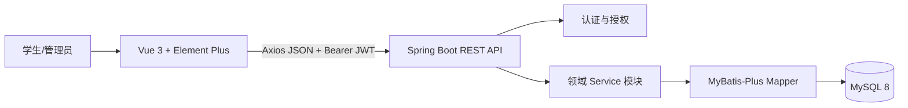
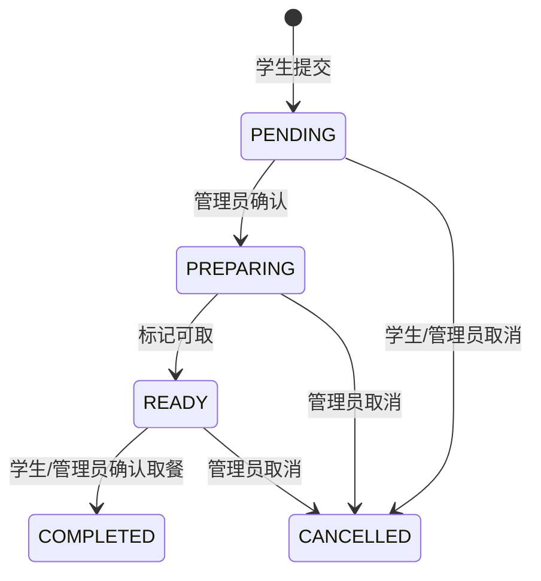

# 系统架构设计

## 总体结构

浏览器 Vue 3 单页应用经 Axios 调用 Spring Boot REST API，后端模块化单体通过 MyBatis-Plus 访问 MySQL 8。无需 Redis、消息队列或微服务。

## 前端建议

页面分学生和管理员路由；`src/api` 按领域封装，Axios 拦截器附 JWT 并统一处理错误；路由守卫用于导航体验。令牌可用 sessionStorage；后端仍须授权。页面包括登录注册、首页、菜品列表详情、购物车、订单、个人中心和后台管理页面。

## 后端分层与模块

单 Maven 应用，领域包建议 `auth/user/category/dish/cart/order/review/statistics`，每领域内 controller/service/mapper/entity/dto/vo；`common` 只放统一响应、异常、分页等通用能力。Controller 做 HTTP/校验，Service 做规则/事务，Mapper 做数据访问。Spring Security 配 JWT 过滤器和角色授权，BCrypt 密码。

统一响应 `{code,message,data}`；分页 data 为 `records,total,page,size`。参数错误、未认证、无权限、资源不存在、状态冲突分别映射 400/401/403/404/409。

## 订单状态与一致性

下单事务验证购物车、菜品状态、预约规则；按菜品 ID 顺序执行 `UPDATE dishes SET stock=stock-? WHERE id=? AND status='ON_SALE' AND stock>=?`；任一更新失败回滚；读取数据库价格计算金额，保存订单和明细快照，清空已下单购物车。取消时以当前状态条件更新订单，只有更新成功才回补明细库存，操作同一事务。幂等键 UUID 唯一约束，重试复用同键。

## 配置与取舍

本地分别运行 Vite、Spring Boot，开发代理 `/api`。数据库凭据、`JWT_SECRET`、CORS 来源用环境变量/本机配置，不入 Git。JWT 建议 2 小时，不做刷新/黑名单，退出由前端清除。菜品图片为 URL。统计用 MySQL 聚合查询。固定预约时段和模拟订单流程控制开发范围。
